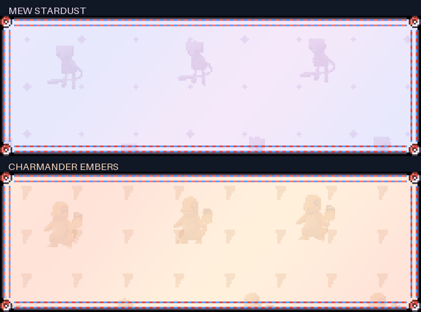
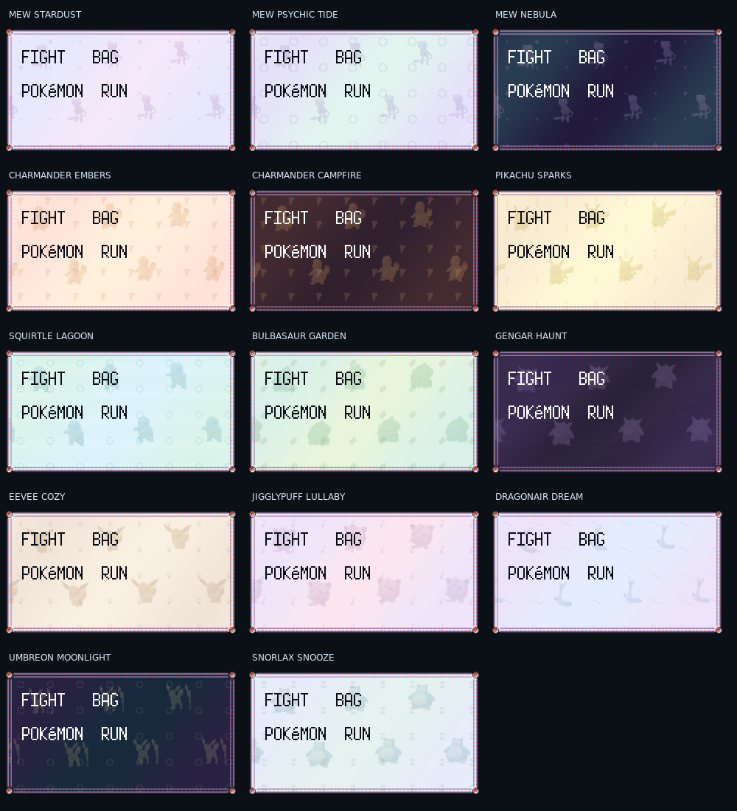

Menu Customizer 3.24.2 - Inner selector and mod value margins

Reserve space inside Gen IV borders for customization-menu selectors. Bound mod-menu values, including numbers, by the frame interior so Tool Music values clear the right side.

Menu Customizer 3.24.1 - Mod Manager selector alignment

Align mod entry labels and move their selector beside the selected label, including center/right justification.

Menu Customizer 3.24.0 - Independent Mod Menus profile

Add a shared, independent Mod Menus profile for the Mods manager and child mod settings menus. Controls live in existing Text/Font and Layout, Decapitalization, Colors, Shadows, Borders, Backgrounds and Selectors pages. Includes text effects and global control/theme integration.

Menu Customizer 3.23.10 - Options title border inset

Position customization page titles inside the selected frame left inset, including wide Gen IV borders.

Menu Customizer 3.23.9 - Dialogue names after token expansion

Apply selected dialogue casing after PLAYER/RIVAL tokens expand, using names from that dialogue game save. Sentence and Title Case normalize player/rival names; vanilla remains unchanged.

Menu Customizer 3.23.8 - Standalone Pokedex formatting

Without KIM1025, wrap descriptions to the actual font width and frame interior with small insets and three rows per page. Show Height in feet/inches and Weight in pounds, replacing metric/abbreviated labels. KIM presentation remains cooperative.

Menu Customizer 3.23.7 - Player and rival name casing

Read names from the actual save.player.name / save.player.rival fields and Continue summary saves. Sentence Case and Title Case show only the first name letter capitalized. Vanilla and lowercase modes remain unchanged.

Menu Customizer 3.23.6 - YES/NO selector inside left margin

Shift YES/NO text right and position its selector on the left, inside the Gen IV frame interior.

Menu Customizer 3.23.5 - YES/NO selector after text

Move the Gen IV YES/NO selector to the right of the selected label, reserving space inside the frame.

Menu Customizer 3.23.4 - Choice palette protection and integer text

Protect DS YES/NO panels from native palette remapping. Queue Emerald choice labels for final-resolution integer rasterization instead of shrinking them into the game canvas.

Menu Customizer 3.23.3 - Single-pass DS choices

Draw Gen IV YES/NO panels, labels and cursor as one scoped pass, avoiding overlapping native text and selector layers.

Menu Customizer 3.23.2 - Gen IV Start arrow right offset

Move the Start menu arrow one pixel right from its v3.23.0 position for Gen IV frames.

Menu Customizer 3.23.1 - Gen IV Start arrow offset

Move the Start menu arrow one pixel farther left when using a Gen IV frame.

Menu Customizer 3.23.0 - Colored party balls and readable move details

Color both Gen 1 party rows red/white, with distinct fainted/status indicators and a configurable empty-slot color under Text / Colors. Move details use two lines each for PP and type with larger normal font.

Menu Customizer 3.22.7 - Visible choices and DS Pokedex text

Restore visible YES/NO labels after frame sizing. Pokedex descriptions paginate within native DS side margins through the existing KIM presentation; entry text uses the matching interior.

Menu Customizer 3.22.6 - Gen IV battle text margins

Battle command, move and dialogue layouts account for asymmetric DS frame sides. PP/type details use a consistent narrow font to fit the right panel.

Menu Customizer 3.22.5 - DS Continue summary and choice boxes

Continue summary uses wider DS-safe label/value columns. YES/NO windows grow to fit the native Gen IV sides, with cursors on the left panel.

Menu Customizer 3.22.4 - DS Start menu selector panel

Move Gen IV menu icon selectors onto the left panel. Return reserved icon space to labels and size Start frames to their longest label so normal entries fit without scrolling.

Menu Customizer 3.22.3 - Gen IV frame text margins

Account for wide asymmetric DS borders in menu alignment and selector spacing. Title menu boxes grow to retain the chosen font size. Start/customizer labels and option values respect the wider interior.

Menu Customizer 3.22.2 - Matching party labels and HP placement

Party level and HP labels use the same font renderer and styling as names. Keep HP counts beside the bar, independent of global text justification. Native label spacing avoids bar/level overlap.

Menu Customizer 3.22.1 - Sentence Case name formatting

Keep Pokemon/Pokémon capitalized in Sentence Case. Player, rival and character names use an initial capital followed by lowercase; species name handling and other case modes remain unchanged.

Menu Customizer 3.22.0 - Generation border groups and Platinum frames

Replace Game Borders pages with generation-sorted groups. Add 20 original Platinum message-box frames and its standard field/system frames, with native DS side widths and custom paper support. Saved border IDs remain unchanged. Source attribution: assets/borders/PLATINUM-SOURCES.md.

Menu Customizer 3.21.5 - Shorter casing menu labels

Remove the repeated Decapitalization suffix from individual menu entries. All Decapitalization remains unchanged.

Menu Customizer 3.21.4 - Proper names in Sentence Case

Preserve capitalization of loaded Pokemon and trainer names, saved player/rival names and nicknames, and story character names when applying Sentence Case. Other casing modes remain independent.

Menu Customizer 3.21.3 - Stable Jump Wave selection clocks

Keep wave timing per menu and selected row so native/customized draw passes and overlapping menus cannot overwrite the first-letter restart. Includes real menu-input and GPU rendering regression coverage.

Menu Customizer 3.21.2 - Restart Jump Wave on selection

Jump Wave starts at the first letter whenever the selected row or menu changes. Uses selection-relative time, preserving phase while the same row remains selected, including duplicate-label rows.

Menu Customizer 3.21.1 - Secondary Jump Wave and speed

SELECTORS now has independent JUMP WAVE on/off and JUMP WAVE SPEED (25-300%). Wave motion combines with other selector markers. Prior wave-only selections continue as wave enabled with an arrow fallback until changed.

Menu Customizer 3.21.0 - Jump Wave selector

Adds JUMP WAVE to Start and menu arrow selector styles. The selected label hops one letter at a time, pauses briefly, then repeats. Preserves label spacing, justification, case and font colors. Covers GB Start/options/customizer and generic menu labels, including the title menu.

Menu Customizer 3.20.2 - Thin borders with animated paper

Fix thin animated borders disappearing when animated backgrounds replace their shader during menu paper tinting. Thin frames now use the captured drawing primitive, keeping background and border shader scopes independent. Includes an actual mirrored-menu GPU regression with animated paper.

Menu Customizer 3.20.1 - Larger Load Report and visibility option

Load Report uses full-size Emerald text, a vertically centered five-row body, centered default alignment and an inset Continue footer. Long reports remain scrollable. SHOW LOAD REPORT under TEXT > FONT AND LAYOUT > LOAD REPORT can skip the screen without disabling save validation. Enabled by default.

Menu Customizer 3.20.0 - Thin animated borders

Adds THIN ANIMATED: Black, Fire Red, Leaf Green, Emerald, Lightning Yellow and Sparkling Crystal. Two-pixel procedural frames have distinct animated highlights/effects, independent per-design speeds, and support existing background choices. Appended choices preserve saved border IDs.

Menu Customizer 3.19.6 - Themes first

Themes is now the first entry in the main customization menu.

Menu Customizer 3.19.5 - More-below arrow

Customization pages show the native down arrow at the bottom right when more entries, including BACK, remain below the visible rows. Hidden at the end of the list. Works on standard and detail pages independently of control-hint visibility.

Menu Customizer 3.19.4 - Seven menu rows

Standard customization pages now show seven rows instead of six. Selection/scrolling use the same seven-row capacity; the final row fits above the optional footer. Detail pages retain their existing capacity.

Menu Customizer 3.19.3 - Respect hidden control hints

Built-in A:OPEN, A:CHANGE and A:SELECT / B:BACK footers now share the Control Hints visibility rule with the outer legend: Hidden removes them, Auto hides them after inactivity, Always retains them.

Menu Customizer 3.19.2 - Decapitalization submenu

TEXT > DECAPITALIZATION now contains ALL DECAPITALIZATION and every per-menu case chooser. Removes the duplicate TEXT CASE chooser from ALL FONTS. Existing saved case settings and global application behavior are preserved.

Menu Customizer 3.19.1 - Preserve full Nidorino intro sprite

In EDGE/HIDDEN intro modes, fit Nidorino independently above the chosen floor instead of applying Gengar's offset past the clipping boundary. Prevents the bottom eight pixels being cut off in both Native and Colorized modes, including ultrawide replay. Gengar remains anchored and animation state restores after drawing.

Menu Customizer 3.19.0 - Load Report customization

Adds independent Gen 1/2 Load Report font style, colors/shadows, case, alignment, background and border. Settings are organized in existing TEXT/BACKGROUNDS/BORDERS menus, with LOAD REPORT under FONT AND LAYOUT. Global controls and themes include this surface. Native report content, scrolling and Continue input remain unchanged.

Menu Customizer 3.18.2 - Optional copyright dates

Restore company-name-only customized credits by default. TEXT > FONT AND LAYOUT > INTRO / TITLE > INTRO COPYRIGHT DATES optionally shows the full version-specific copyright prefixes on intro credits and the title screen. Native credits remain unchanged.

Menu Customizer 3.18.1 - Restore copyright credits

Restore full version-specific copyright/date prefixes on customized Gen 1 intro credits and the title Game Freak line. Adds a pixel copyright glyph to the Emerald renderer with color/shadow support. Complete credits use the small Emerald face to fit without clipping. Native rendering and supplied custom credit strings remain intact.

Menu Customizer 3.18.0 - Colorized intro Pokemon

Adds TEXT > FONT AND LAYOUT > INTRO / TITLE > INTRO BATTLE SPRITES: NATIVE or COLORIZED. Gengar uses purple and Nidorino lavender, retaining black outlines and native animation. Recolored frames are cached and reused by sprite replay, custom backgrounds, bar modes and ultrawide presentation. Native remains the default.

Menu Customizer 3.17.2 - Ultrawide intro actors

Scale intro Pokemon proportionally with window aspect above 16:9, capped at 160%. Render actors in the full-window pass to avoid narrow-canvas cropping, preserving their common bottom anchor and selected cinematic bar mode. Standard/narrow windows retain existing scale.

Menu Customizer 3.17.1 - Intro sprite floor

EDGE and HIDDEN intro bar modes move both Pokemon down together until Gengar rests on the lower bar or bottom of the native scene. Original mode is unchanged. Draw offsets also apply to sprite replay and restore animation coordinates after drawing, including errors.

Menu Customizer 3.17.0 - Title Options and intro bar modes

Title-screen Options now uses the same customized options renderer before a world is loaded. Adds TEXT > FONT AND LAYOUT > INTRO / TITLE > INTRO BATTLE BARS: ORIGINAL, EDGE (8-pixel outer bars), or HIDDEN. Expanded sprite replay clipping reveals the full Gengar/Nidorino artwork in EDGE/HIDDEN modes. Original bar mode remains the default; custom-background fades retain their timing.

Menu Customizer 3.16.0 - Themed design menus and aligned selectors

Organizes wallpapers and animated borders into themed submenus: gradients, game-version gradients, Pokemon, psychedelic/effects, red psychedelic, fire, black artwork and forest/grass. Large design lists are split into pages of at most 24 choices. Stored IDs and selections are preserved. Menu selectors now follow centered/right-aligned labels, including the title menu while Continue is open.

Menu Customizer 3.15.0 - Battle status customization

Adds Gen 1 battle level/status and HP label/number colors and shadows under TEXT, plus partial status-frame color, shadow and visibility under BORDERS. Includes static and animated palettes, global font colors/shadows, and theme presets. Works inside the native HUD draw and KIM capture without changing geometry or HP fill colors. Unset controls retain native rendering. Other generations retain their status renderers.

Menu Customizer 3.14.0 - Game version gradients

Adds seven matching animated gradient sets: RED VERSION, BLUE VERSION, GREEN VERSION, YELLOW VERSION, GOLD VERSION, SILVER VERSION and CRYSTAL VERSION. Each is available for text/shadows, backgrounds and animated borders, including global pickers and per-design animation speeds. New choices are appended so existing saved selections keep their designs.

Menu Customizer 3.13.4 - Continue menu justification

Keep the title menu justification while the Continue save summary is open. The retained title menu no longer loses alignment just because the summary becomes the top screen. Verified identical underlying-menu pixels before, during and after Continue for left, center and right justification in native and Emerald styles.

Menu Customizer 3.13.3 - Fade intro into selected background

The Gengar/Nidorino intro fades its foreground and cinematic bars into the selected intro background, including animated designs. The post-fade hold stays on that background without a white flash. Native background keeps the original white fade. Fade timing, title transition and intro state are preserved.

Menu Customizer 3.13.2 - Splash animation optimization

Batch falling stars into one animated-color setup per frame instead of up to sixteen. Cache star positions between movement steps, combine true-color marking, and precache splash masks and the selected star shader before the splash. Animated colors and continued falling motion remain enabled. GPU checks verify one setup per frame and zero warm-path canvas/shader creation.

Menu Customizer 3.13.1 - Intro cinematic alignment

Align Gengar/Nidorino cinematic bars with the UI sprite canvas rather than the independently zoomed world. This prevents the bottom bar from rising over the actors when world and UI scales differ. Preserves the original 32..112 scene band and intro timing.

Menu Customizer 3.13.0 - Falling star customization

TEXT > COLORS > GAME FREAK FALLING STARS controls the splash stars independently from the emblem and wordmark. Supports the full static and animated color catalog; global colors and themes include it. Falling waves keep moving past the old cap and bottom bar until they leave the screen or the intro advances. Other intro timing and the shooting star remain unchanged.

Menu Customizer 3.12.1 - Start selector visibility

Fix global font alignment shifting start labels before selector placement. Start/options retain their own layout. Dots and underlines now render animated selector colors through the color shader instead of using its black base color. Verified all 14 selector choices in native and Emerald fonts for Gen 1 and Gen 2, including centered global alignment.

Menu Customizer 3.12.0 - Independent animation speeds and display fixes

Backgrounds and Borders each have ANIMATION SPEEDS; TEXT has ANIMATED COLOR SPEEDS. Every animated design has its own saved rate (0% pauses, up to 400%). Old shared rates remain a fallback until customized; the shared speed row is removed. Sentence case capitalizes standalone I and contractions. Game Freak color/shadow controls target the actual Gen 1 splash emblem and wordmark, including a supplied studio logo, while copyright credits use normal intro settings. Start selectors use row geometry rather than capitalized label matching, including native start menus without a stamped screen ID.

Menu Customizer 3.11.0 - Green landscapes and battlefields

Adds ten matching animated green tree/grass backgrounds and borders. BACKGROUNDS > BATTLEFIELD selects scenery separately from BATTLE MENU. NATIVE restores existing scenery. Gen 1 requires KIM1025 1.7.46 and its HD scene; Gen 3 supports KIM backgrounds and native terrain. Gen 2 battle rendering is unchanged. Existing selections and settings are preserved.

Menu Customizer 3.10.0 - Independent menu text settings

TEXT > FONT AND LAYOUT now contains menu-specific submenus, with only global controls at its root. Each menu has independent decapitalization; unset choices preserve the prior global setting. ALL DECAPITALIZATION and ALL FONTS intentionally update all menu case settings. Covers menus, start/options, dialogue, intro/title, save summary, Mart, PC, battle/names, party, bag, Pokemon summary, Pokedex and trainer card. TEXT > COLORS includes GAME FREAK separately from other intro text; global colors and themes include it. Native Gen 2 print paths also apply the selected case.

Menu Customizer 3.9.0 - Dialogue casing fixes and vivid black psychedelia

Fixes actual Gen 1/2 dialogue capitalization before glyph encoding and keeps contraction glyphs literal, so sentence case displays Don't rather than Don'T and Title Case reaches dialogue. Adds ten animated rainbow-on-black border/background pairs: spirals, kaleidoscopes, fractal vortices, mandalas, acid waves, tunnels, lotus, mirrors, infinity gates and rosettes. Wide black bands keep black dominant. Existing saved choices remain stable.

Menu Customizer 3.8.0 - World void backgrounds

BACKGROUND settings now include INDOOR VOID and OUTDOOR VOID. Choose any static or animated background independently; NATIVE restores the recomp fill, including its existing trees/water/black choices. Defaults remain NATIVE. Backgrounds paint only outside map bodies and connected neighbors. ALL BACKGROUNDS also updates enabled void backgrounds without enabling native ones. Gen 1/2 ground renderers and the Gen 3 native field renderer are supported.

Menu Customizer 3.7.0 - Matching black psychedelic backgrounds

Adds 20 animated black backgrounds: two variations for each existing black psychedelic border family. Thin muted violet patterns on near-black fields. Find their BLACK-prefixed names in the consolidated DESIGNS list, including ALL BACKGROUNDS. All existing saved design IDs remain unchanged.

Menu Customizer 3.6.5 - Title Case

Adds TITLE CASE after LOWERCASE in decapitalization, Intro text case and ALL FONTS. Capitalizes each word, preserves control tags and apostrophes, and supports common accented Latin letters. Existing mode IDs and settings remain unchanged.

Menu Customizer 3.6.4 - Title artwork

Find ASH TITLE ARTWORK (OFF/ON) under TEXT > FONT AND LAYOUT. The HD title logo now draws only at final resolution, avoiding stepped edges left by its low-resolution underlay. Native logo mode is preserved.

Menu Customizer 3.6.3 - Compact labels

Removed redundant Background, Border and Text wording inside matching submenus. Color and Shadow entries use their submenu context too. Only displayed labels change; settings and callbacks are preserved.

Menu Customizer 3.6.2 - Dialogue and font navigation

Dialogue controls now live in the existing Text, Borders and Backgrounds submenus. ALL FONTS is under TEXT > FONT AND LAYOUT. Saved settings are preserved.

Menu Customizer 3.6.1 - Settings navigation

Poke Mart, PC and Intro/Start options now live in the existing customization categories. Decorative backgrounds share one DESIGNS list; animated borders share one ANIMATED BORDERS list. Saved settings and design IDs are unchanged.

Menu Customizer 3.6.0 - Black artwork collection

20 new animated borders and 20 new animated backgrounds: ten psychedelic and ten Pokemon designs in each set. Mostly black with sparse muted accents. Available in BLACK PSYCHEDELIC and BLACK POKEMON groups, including ALL BORDERS and ALL BACKGROUNDS. Saved design IDs are preserved.

# Menu Customizer 3.5.0 — ALL FONTS

Open OPTIONS → MENUS → ALL FONTS to change font style (NATIVE/EMERALD), font color, shadow color/opacity, alignment, text case and shared text effects together. Font choices fan out to menu, dialogue, intro/save summary, battle/name/level-up text and custom Mart/PC profiles. Choosing a solid font color clears older alternating-color presets so the new choice is visible.

Alignment stays inside text cells: start/dialogue settings are synchronized, boxed menu/Mart/PC labels and battle labels/prompt/details/stat labels align within their available space. Prices and stat values retain their numeric anchors. Partly covered parent menus keep their existing placement; alignment does not resize boxes. Themes reset the shared font controls to their coordinated defaults.

Validated in all eleven games with KIM1025; Native/Emerald and all three alignments rendered in native LOVE for Red, Gold, FireRed, Ruby and Emerald. Focused LuaJIT/Lua 5.3 tests cover settings persistence, shared controls, numeric columns, covered menus and error cleanup. No live playthrough was performed. Restart after installing. Johnto and other mods are unchanged.

# Menu Customizer 3.4.0 — Complete themes and animated dark modes

OPTIONS → MENUS → THEMES now includes 14 coordinated presets. All eight existing themes cover the separate Mart/PC profiles and their text effects, dialogue boxes, battle/level-up windows, intro and save summary styling. Reapply an existing theme to extend it to the new surfaces.

Six new presets: DARK MODE - OBSIDIAN, DARK MODE - ABYSS, DARK MODE - VIOLET, GLACIER, SCARLET LOUNGE and MEW NEBULA. The three dark modes add matching animated dark gradient borders and backgrounds, bright readable text and coordinated selector accents. New palette/frame IDs are appended; existing saved design IDs retain their meanings.

ALL BORDERS and ALL BACKGROUNDS now reach custom Mart and PC windows as well as existing surfaces. ALL COLORS, ALL SHADOWS and ALL SHADOW OPACITY also include the new profiles. These global controls are now exposed in Gen 3. Enabling an inherited profile copies its current global appearance first, avoiding stale disabled overrides.

Validated: all 14 themes and global controls in all eleven games with KIM1025, independent profile regressions, animated dark Mart/PC rendering in native LOVE across five game families, sampled dark-background contrast, and focused LuaJIT/Lua 5.3 compilation/rendering regressions. No live playthrough was performed. Restart after installing. Johnto and other mods are unchanged.

# Menu Customizer 3.3.5 — Small-window battle readability

Names retain readable integer pixels, fit inside the window and reserve clearance above level/status labels. Compact command layouts use the actual eight-pixel selector footprint and a narrow prompt to avoid unnecessary shrinking. Requires KIM1025 1.7.45 for cooperative HUD placement. Validated with 1,440 layout checks and 186,895 real KIM GPU pixel/clearance checks across small, large and high-DPI windows, plus dual-runtime regressions and eleven-game startup.

# Menu Customizer 3.3.4 — Consistent dex number marker

The summary No. marker and special dot now use the selected menu font alongside the Pokédex number. Native-font mode retains its original artwork. Focused LuaJIT/Lua 5.3 tests and Red/Gold combined KIM startup pass.

# Menu Customizer 3.3.3 — Crisp stats and fixed battle layouts

Level-up stats now draw directly in the final framebuffer using the battle command font, with whole physical pixels. The native stat window keeps its normal-size geometry at every font setting. This replaces fractional text drawn into the tiny GB canvas.

Battle command, dialogue and move frames retain their normal-size rectangles when LARGE or EXTRA LARGE is selected. Text fits the existing cells, reducing spare spacing and capping size where needed. Selectors reserve their full 16-pixel footprint and a gap before labels, including custom selectors. PP/type details stay in their own column, and native HUD anchors no longer inherit menu font enlargement. Gen 1/2 command actions and the stat confirmation flow are preserved.

Validation: LuaJIT/Lua 5.3 compilation and focused regressions, 1,657 move/command layout checks covering all sizes and cursor positions, eleven-game combined KIM startup, native LOVE GPU command/move/stat rendering in Red/Gold/FireRed/Ruby/Emerald, all stat sizes/pages, and pixel-for-pixel GB stat glyph comparisons against the battle font atlas. No live playthrough was performed. Restart after installing. Johnto and other mods are unchanged.

# Menu Customizer 3.3.2 — Battle command and stat corrections

BAG and POKéMON now follow the native command actions in Gen 1/2; Gen 3 retains its own action order. Level-up stat text uses the same GB dialogue scale, with room for labels and values. The Gen 1 HUD yields while the native stat window is open so KIM cannot draw it over the numbers. Battle styling, font-size settings and native stat-window confirmation remain intact.

Validated with LuaJIT/Lua 5.3 regression tests, all eleven games loading alongside KIM1025 1.7.44, and native LOVE GPU stat rendering in Red, Gold, FireRed, Ruby and Emerald at all font sizes. No live playthrough was performed. Restart after installing. Johnto and other mods are unchanged.

# Menu Customizer 3.3.1 — Level-up stat panels

Level-up stat windows now inherit battle UI border style, background, text/shadow colors, text effects, opacity and font choices across all eleven games. Panels expand and fit their rows at larger battle font sizes. Gen 3 retains its increase and total pages and the native confirmation callback. Rare Candy stat windows use the same styling. No extra settings are needed.

Validated with native LOVE GPU rendering in Red, Gold, FireRed, Ruby and Emerald at all three font sizes, plus Gen 3 page advancement/callback checks, eleven-game combined KIM startup, full LuaJIT/Lua 5.3 compilation and focused battle rendering regressions. No live playthrough was performed. Restart after installing. Johnto and other mods are unchanged.

# Menu Customizer 3.3.0 — Mart, PC and dialogue profiles

Built from GitHub's latest v3.2.123 source (5cbd4054eceef73c6d0388e9edec8dda3d9285e5).

Open OPTIONS → MENUS → POKE MART, PC MENUS or DIALOGUE BOXES.

- POKE MART and PC MENUS have independent font, border, background, text-color and text-shadow controls. Editing a control enables CUSTOM; STYLE → USE MENU restores inheritance without deleting the custom choices.
- DIALOGUE BOXES brings the existing dialogue font, border, background, text/shadow colors and alignment together on one page. RESET DIALOGUE restores its defaults. Existing saved dialogue choices are retained.
- Use the full existing border and background catalogs, including animated/Pokémon designs. Profiles follow the existing shared/per-game settings preference.
- Native shop transactions, quantities, stock, PC actions, storage artwork, scrolling and confirmation flow remain intact. Gen 1/2 Mart and PC stacks now participate in the existing menu compositor. Gen 3 shop panels and native PC windows receive the selected visual profile.

Validation: full Loader/Sandbox integration with KIM1025 1.7.43 in all 11 games; dedicated options navigation, independent persistence, shared/per-game restoration, nested callbacks, error/disabled-scope cleanup; native LOVE GPU Mart/PC rendering in Red, Gold, FireRed, Ruby and Emerald. Whole-source compilation and focused native-animation/layout/font/color regressions pass in LuaJIT and Lua 5.3. Four historical standalone fixtures (animated_gradients, rs_render, rs_start_selectors and gb_menus) still fail with the same stale expectations/missing fixture dependencies on untouched v3.2.123; they are not counted as passing. No live playthrough was performed.

Restart after installing. Johnto and other mods are unchanged.

# Menu Customizer 3.2.123 — Keep the custom battle UI during moves

Remove 3.2.122's animation-dependent UI/palette/font bypasses. The selected battle menu, HUD style and typography remain active throughout attacks instead of revealing the vanilla battle screen. Retain 3.2.121's direct native animation-layer delegation; no replacement move player or artwork is installed.

Use with KIM1025 1.7.43, whose focused transparency fix removes opaque native palette-region paper while keeping the HD scene and native effects active. Fully exit/reopen the game after updating.

Validation: source compilation, native effect delegation, Emerald move layout, battle-frame geometry and scaling under LuaJIT/Lua 5.3; eleven-game combined KIM startup under LuaJIT. The historical battle_move_screen cursor assertion still also fails on the untouched 3.2.120 baseline. Johnto remains untouched.

# Menu Customizer 3.2.122 — Yield attack frames to the native renderer

Bypass custom battle text canvases, protected palette-zone drawing, cloned wide-battle rendering, HUD substitution and font/scale scopes during Gen 1 move animation, native picture effects, fades, shakes, flashes and resting catch frames. Preserve native drawing and arguments, then resume menu customization when effects finish.

Built from GitHub's latest 3.2.121. Install alongside KIM1025 1.7.42 and fully exit/reopen the game. Johnto remains untouched.

Validation: native delegation and resumption across 16 animation/effect states, whole-source compilation, native effect delegation, Emerald move layout, frame geometry and menu scaling under LuaJIT and Lua 5.3; combined KIM startup across eleven games under LuaJIT. The old battle_move_screen cursor assertion also fails on untouched 3.2.120 and remains outside this change. Live gameplay was not restarted automatically.

# Menu Customizer 3.2.121 — Native move-effect frames

Remove the Emerald-style wide battle menu's animation-frame inspection, filtering and position offsets. Delegate the animation layer directly to BattleState:drawAnimLayer with native coordinates and palettes. Frames that do not use the engine's OAM step table are no longer silently dropped.

Built from GitHub's latest 3.2.120 source and release. Validate native frame delegation, unchanged animation state, whole-source compilation and battle-menu rendering under LuaJIT and Lua 5.3. Install with KIM1025 1.7.40 and restart. No live battle reproduction was performed.

# Menu Customizer 3.2.120

Add ALL SHADOW OPACITY under TRANSPARENCY. Adjust every menu, dialogue, intro, battle-text, and Pokemon-name shadow together from 0 percent (hidden) to 100 percent (fully opaque), in 5 percent steps. Individual shadow transparency controls remain available. Restart to load the update. Tests skipped as requested.

# Menu Customizer 3.2.119

Add ten red fire-themed animated backgrounds and ten matching borders: Crimson Inferno, Scarlet Embers, Ruby Lava, Red Flame Curtain, Carmine Firestorm, Molten Red Rivers, Phoenix Fire, Scarlet Heat Haze, Volcanic Heart, and Crimson Fire Whirl. Find both sets under RED FIRE. Preserve existing saved selection IDs. Restart to load the update. Tests skipped as requested.

# Menu Customizer 3.2.118

Add game-wide ALL COLORS and ALL SHADOWS selectors under TEXT / COLORS and TEXT / SHADOWS. Apply selected colors to menu, dialogue, intro, battle text, Pokemon names, and selector ink, and shadows to every text scope. Individual settings remain available. Include named selector values. Restart to load the update. Tests skipped as requested.

# Menu Customizer 3.2.117

Add ALL COLORS under TEXT / COLORS and ALL SHADOWS under TEXT / SHADOWS. Apply each selection to menu, dialogue, intro, battle text, and Pokemon name settings together; ALL COLORS also updates selector ink. Individual controls remain available. Restart to load the update. Tests skipped as requested.

# Menu Customizer 3.2.116

Add twenty red-dominant psychedelic animated backgrounds and twenty matching animated borders, with distinct vortex, mandala, ripple, grid, plasma, tunnel, and fractal patterns. Find backgrounds under TRIPPY and borders under RED PSYCHEDELIC. Append choices without changing existing saved selections. Restart to load the update. Tests skipped as requested.

# Menu Customizer 3.2.115

Extend the Red/Blue title Pokemon entrance and exit to the actual window edges. Render moving portraits in screen space behind the title foreground so the central game canvas no longer clips them, and derive endpoints from current window/UI scale for ultrawide and resized windows. Retain the normal resting position and five-pixel vertical adjustment. Restart to load the update. Tests skipped as requested.

# Menu Customizer 3.2.114

Group TEXT into Font and Layout, Colors, Shadows, Menu Effects, Battle Effects, and Name Effects submenus. Add ALL BORDERS and ALL BACKGROUNDS at the top of their pages to apply selections across menu, dialogue, save, battle, and intro background settings. Existing per-screen controls and saved IDs are retained. Restart to load the update. Tests skipped as requested.

# Menu Customizer 3.2.113

Exclude Font.draw and Font.drawCode glyph rendering from the intro white-paper transparency shader. White font atlas masks were being erased, hiding intro credits and title captions. Preserve full-window wallpaper and cinematic masks. Installed 3.2.112 source was confirmed to match the workspace before this fix. Restart to load the update. Tests skipped as requested.

# Menu Customizer 3.2.112

Restore intro and title-screen text by restricting background suppression to full-screen paper rectangles on the boot canvas. Preserve small glyph/effect rectangles and offscreen text canvas clears. Keep the single full-window wallpaper and intro battle bars. Restart to load the fix. Tests skipped as requested.

# Menu Customizer 3.2.111

Apply the intro battle cinematic masks after final-resolution sprite replay, preventing Gengar and Nidorino from overlapping either full-width bar on ultrawide windows. Preserve the native fade colors and Game Freak splash behavior. Restart to load the update. Tests skipped as requested.

# Menu Customizer 3.2.110

Extend the top and bottom Gengar/Nidorino intro battle bars across the entire window width, including 32:9 fullscreen. Match the native bar color during fades and fill vertical margins too. Keep the Game Freak splash bar-free. Restart to load the update. Tests skipped as requested.

# Menu Customizer 3.2.109

Raise the Pokemon title logo seven logical game pixels when LARGE or EXTRA LARGE intro text is enabled. Normal text retains its original logo position. Restart the game to load the update. Tests skipped as requested.

# Menu Customizer 3.2.108

Remove the top and bottom black mask bars during the Game Freak logo/emblem splash, allowing the full-window wallpaper to remain visible behind the artwork. Keep the fight cinematic masks and other screens unchanged. Restart the game to load the fix. Tests skipped as requested.

# Menu Customizer 3.2.107

Render one background across the entire intro/title window. Remove the second background from the central game canvas, retain transparent foreground art, and use the full window aspect ratio for patterns, including 32:9. Restart the game to load the fix. Tests skipped as requested.

# Menu Customizer 3.2.106

Extend customized intro and start-screen backgrounds to the entire window, including ultrawide side areas. Continue patterns at the original game scale and origin rather than stretching the background. Keep foreground art, text, and menu placement unchanged. Default white remains white when no background is selected. Restart the game to load the update. Tests skipped as requested.

# Menu Customizer 3.2.105

Move the Red/Blue title Pokemon and trainer portraits up five logical game pixels, including Ash and the native trainer. Move matching palette regions and final-resolution sprite redraws with the artwork. Restart the game to load the update. Tests skipped as requested.

# Menu Customizer 3.2.104

Enlarge the title choice menu for LARGE and EXTRA LARGE text. Measure the longest label at one shared font scale, increase row spacing and top inset, and fit the box within the screen. Extra-large text uses the largest size that fits all visible choices, with scrolling for additional mod entries. Restart the game to load this fix. Tests skipped as requested.

# Menu Customizer 3.2.103

Center the start-screen copyright after large-font scaling. Save confirmation dialogue now uses the save menu border and background settings. Replace Ash title artwork with a transparent Pokemon Showdown trainer sprite, cropped at draw time to its opaque bounds and rendered with nearest filtering. Restart the game to load the update. Tests skipped as requested.

# Menu Customizer 3.2.102

Use the same standard-window border and background renderer for the Return to Main Menu prompt as its YES/NO popup. Preserve the wide prompt layout, confirmation controls and overlap fix. Restart after installing.

Validation: native confirmation draw and hook restoration, LuaJIT/Lua 5.3 compilation.

# Menu Customizer 3.2.101

Fix overlapping Start-menu labels and frames in the Exit confirmation. Draw only the confirmation prompt, YES/NO popup and active selector while confirming; bypass Start-menu label justification for this dialog. Restore all temporary draw hooks on errors.

Validated against the native engine StartMenu.draw: parent labels/frame suppressed, prompt/YES/NO/cursor retained and hooks restored after errors. Restart after installing.

# Menu Customizer 3.2.100

Add one measured small-font space between Lv and the level value. Keep the level number anchored and retain the one-pixel vertical alignment and healthbox transparency fixes. Restart after installing.

# Menu Customizer 3.2.99

Raise current/max HP values one game pixel and raise the Lv label one pixel to align it with level digits. Retain the healthbox and EXP-track transparency fixes. Restart after installing.

Validated rendered healthboxes with both genders and 0/50/100% opacity; unrelated native pixels remain unchanged.

# Menu Customizer 3.2.98

Fade the complete EXP strip beneath the player HP numbers with the healthbox. Its baked pale track previously remained fully opaque and appeared as a white line at reduced battle opacity.

Validated every pixel of the EXP strip for both genders at 0% and 50% opacity, with pixel-identical native healthbox rendering at 100%. HP-paper and placeholder-cleanup regressions still pass. Restart after installing.

# Menu Customizer 3.2.97

Fix player HP paper and baked level-placeholder cleanup escaping battle transparency. Composite the healthbox and its cleanup fills before fading; draw names, gender, levels, HP numbers and gauges separately. This removes the stray cleanup mark beside the player gender glyph at reduced opacity.

Based on the latest GitHub main and release 3.2.96. Validated with real Emerald assets at 0%, 50% and 100%, both genders, zero-opacity placeholder checks, and pixel-identical native rendering at 100%. All Lua sources compile under Lua 5.3. Restart after installing.

# Menu Customizer 3.2.96

Fix the theme-preview crash by using the name effect group accepted by the text-effects API instead of battle_name.

Validation: all eight theme presets with strict effect group validation, real text-effects API checks, preview regressions and full compilation under LuaJIT and Lua 5.3. Restart after installing.

# Menu Customizer 3.2.95

Remove all POKEMON ANIMATED scene backgrounds and their submenu. Retain numeric slots solely for saved-setting compatibility; retired selections render calm navy paper instead of animated scenes.

Replace the theme list with eight coordinated full-interface presets: Midnight Aurora, Ocean Glass, Lavender Dusk, Forest Calm, Warm Paper, Silver Noir, Rose Quartz and Amber Lounge. Use solid readable backgrounds, contrasting text/accent colors, coordinated borders and fade transitions. Set menu/dialogue/battle/intro/save/Pokedex styling and selector colors together; reset prior conflicting visual defaults, effects and geometry.

Validation: all eight theme presets, background preview isolation, full LuaJIT/Lua 5.3 compilation. Live gameplay was not exercised. Restart after installing.

# Menu Customizer 3.2.94

Replace the dialogue border on/off row with the independent DIALOGUE BORDER design picker. NONE disables the custom dialogue border; choosing a design enables it. Dialogue no longer inherits MENU BORDER. Applies to GB and Gen 3; existing explicit design IDs remain intact.

Validation: full LuaJIT/Lua 5.3 compilation and preview regressions. Restart after installing.

# Menu Customizer 3.2.93

Show single-choice border families as directly selectable entries instead of one-item submenus. Rename surviving Pokemon borders: Lucario Aura Trails, Charizard Ember Flow, Blastoise Tidal Waves, Mewtwo Psychic Dance, Gengar Shadow Eyes and Lapras Pokeball Orbits. Preserve numeric IDs and saved selections, previews and multi-choice border groups.

Validation: LuaJIT/Lua 5.3 compilation and preview regression checks. Restart after installing.

# Menu Customizer 3.2.92

Left-align ordinary options values in the native shared value column so short and long values start uniformly. Preserve cartridge choice layout, selector positions and Continue summary spacing.

Validation: LuaJIT/Lua 5.3 compilation and preview regressions. Restart after installing.

# Menu Customizer 3.2.91

Center cartridge choice markers beside option text using a two-pixel downward offset, between the previous too-high and too-low positions. Leave ordinary row selectors unchanged.

Validation: selector dispatch, selected-color and preview checks; full compilation under LuaJIT and Lua 5.3. Restart after installing.

# Menu Customizer 3.2.90

Remove the extra four-pixel row-centering offset from cartridge choice markers so they align with Text Speed and Button Mode text. Ordinary row selectors remain unchanged.

Validation: all choice styles and selected-color checks, preview regressions and full compilation under LuaJIT and Lua 5.3. Restart after installing.

# Menu Customizer 3.2.89

Right-align ordinary settings values, including selector names, OPEN labels and percentages, using the active font width and matching the window inset. Preserve multi-choice cartridge control layout and choice markers. Apply to Gen 3 options and GB native options value rows.

Validation: full compilation under LuaJIT and Lua 5.3 and existing preview regression checks. Live gameplay was not exercised. Restart after installing.

# Menu Customizer 3.2.88

Match Continue details right inset to the four-pixel left inset. Position the player name beside PLAYER with a six-pixel gap, and place TIME and BADGES six pixels before their right-aligned values. Measure active fonts and values when positioning; preserve child-menu layout.

Validation: full compilation under LuaJIT and Lua 5.3 and existing preview regression checks. Live gameplay was not exercised. Restart after installing.

# Menu Customizer 3.2.87

Add SELECTORS > CHOICE SELECTOR with an independent choice style and selected text color. Emerald cartridge choices, including Text Speed and Button Mode, support all 13 existing selector styles plus TEXT COLOR (the default). Replace the fixed underline with the configured style. Ordinary menu arrows retain their own setting.

Validation: all selector styles dispatch independently and selected text color follows all values, preview regressions and full LuaJIT/Lua 5.3 compilation. Live gameplay was not exercised. Restart after installing.

# Menu Customizer 3.2.86

Inset RSE main-menu option labels and left-column Continue details by four logical pixels from the interior border. Preserve right-aligned details and child-menu layout.

Validation: both Lua runtimes compile and existing preview regressions pass. Restart after installing.

# Menu Customizer 3.2.85

Underline the active Emerald cartridge-option choice with a contrasting marker, so custom text palettes cannot hide which Text Speed or Button Mode value is selected. Apply to all visible cartridge choice rows.

Validation: marker follows all three values; preview regressions and full compilation under LuaJIT and Lua 5.3. Live gameplay was not exercised. Restart after installing.

# Menu Customizer 3.2.84

Keep settings labels and selected-choice indicators on saved values while live previews temporarily restyle the current options window. Prevent background previews from making other background options appear changed. Applies to GB and Gen 3 menus. Restore all wrapped callbacks and preview state after drawing errors.

Validation: independent saved background values/labels during previews, selection indicators, error restoration, existing preview/case regressions and full compilation under LuaJIT and Lua 5.3. Live gameplay was not exercised. Restart after installing.

# Menu Customizer 3.2.83

Remove font paper from RSE Continue/main-menu captions, preserving foreground and shadows and restoring the printer on errors.

Validated transparent caption options and restoration under both Lua runtimes, full compilation, and installed-engine options integration checks. Live gameplay was not exercised. Install alongside 1025Dex 1.2.53 and restart.

# Menu Customizer 3.2.82

Fix Emerald OPTIONS integration: forward native cartridge-row metadata so Text Speed and Button Mode retain their native controls; read Emerald's actual page state to draw custom selectors and highlights on all settings pages, including BACK.

Suppress the original options canvas only during gameplay's screen-space replay. Keep the title/main-menu OPTIONS canvas visible instead of producing a black screen.

Validation: actual Emerald input-handler checks for Text Speed and Button Mode, selector and BACK placement, render-guard checks, preview restoration regressions, and full compilation under LuaJIT and Lua 5.3. Live gameplay was not exercised. Restart after installing.

# Menu Customizer 3.2.81

Draw the title-screen Ash illustration once through the final-resolution sprite pass. Remove its low-resolution underlay, which can leave dark speckles and stair-stepped edges showing through the artwork's alpha. Retain linear image filtering and use straight-alpha blending for the fallback renderer.

Restart to load the update.

# Menu Customizer 3.2.80

Give native GB intro/title customization a dedicated INTRO / START SCREEN submenu and independent presentation settings.

- Independent intro font, size, foreground color, shadow color, effects/presets/transparency/speed and capitalization. Intro and title text, Game Freak artwork and stars use the intro text settings instead of MENU settings. Background selection remains independent.
- Add TITLE TRAINER: VANILLA or ASH ARTWORK, using the supplied transparent Ash illustration with preserved proportions and final-resolution UI replay.
- Add TITLE LOGO: VANILLA or HIGH RESOLUTION, retaining the supplied Pokemon logo as the high-resolution choice.
- Preserve native Pokemon/trainer sprite protection and avoid repainting the title trainer during sprite replay when Ash is selected.

Validation: Lua source compilation and focused shared-settings checks under LuaJIT and Lua 5.3. Live gameplay was not restarted. Restart to load the update.

# Menu Customizer 3.2.79

Keep native Gen 1 options-card selection highlights within the card's 16-pixel interior rather than covering the entire 32-pixel row pitch. Use an 8-pixel highlight for the unframed BACK footer, preventing the highlight from extending below the screen and revealing the overworld.

Restart to load the fix.

# Menu Customizer 3.2.78

Use the selected menu text foreground color for the GAME FREAK splash lettering and emblem, matching the falling stars while custom intro backgrounds are active. Keep white paper transparent and preserve the full-color Pokemon title logo.

Restart to load the update.

# Menu Customizer 3.2.77

Remove white paper from the native GAME FREAK emblem above the splash lettering and tint the falling/shooting star artwork with the selected menu font foreground color while custom intro backgrounds are active. Pokemon and trainer white-detail preservation remains active.

Restart to load the update.

# Menu Customizer 3.2.76

Remove the white paper between GAME FREAK splash-screen letters. Exclude the native lettering asset from the portrait exterior-mask override so it uses the original transparent text palette. Pokemon and trainer white-detail preservation remains active.

Restart to load the fix.

# Menu Customizer 3.2.75

Render intro/title Emerald glyphs at whole source-pixel scales instead of fractional 0.5/0.75 scales on the native canvas. Snap text anchors to whole pixels, preserve uniform glyph proportions and baseline alignment, and cap long captions at the largest whole scale fitting the screen width.

The high-resolution logo is preserved. Restart to load the text fix.

# Menu Customizer 3.2.74

Replace the native title-screen Pokemon logo with the user-provided high-resolution color PNG. Crop transparent margins, preserve its aspect ratio and alpha, and fit it to the existing logo area. Replay it through the final-resolution UI sprite pass for sharper rendering instead of relying on the low-resolution game canvas.

Restart the game to load the update.

# Menu Customizer 3.2.73

Add INTRO / START SCREEN FONT (USE MENU, NATIVE, EMERALD) and INTRO / START TEXT SIZE (NORMAL, LARGE, EXTRA LARGE) under TEXT for native Gen 1/Gen 2 boot screens.

Boot text now participates in the shared menu text colors, shadows, effects and decapitalization settings. Render Gen 1 version labels and copyright/studio captions through the selected font when Emerald is enabled. Preserve the Pokemon logo as artwork and retain the separate sprite-white preservation/background-removal paths.

Restart the game to load the update.

# Menu Customizer 3.2.72

Fix intro sprite white details while keeping logo and text paper transparent.

- Restore white-key removal for decorative/logo/font images only; protect Pokemon and trainer drawing.
- Override the native boot sprite palette loader within the active intro draw so it no longer discards every white sprite pixel.
- Build and cache exterior-paper masks from native source assets: white regions connected to the image edge become transparent while enclosed white sprite details stay opaque. Apply this to Gengar/Nidorino intro frames and native trainer palette images, including replay layers.
- Restore temporary image references and sprite-loader hooks after drawing.

Validation: Lua source compilation. Restart the game to load the update.

# Menu Customizer 3.2.71

Preserve white Pokemon and trainer sprite details with custom intro backgrounds. Remove the global white-key image shader; replace only explicit white screen fills and clears, leaving sprite images intact.

Restart the game to load the fix.

# Menu Customizer 3.2.70

Add INTRO / START SCREEN BACKGROUND under BACKGROUNDS for native Gen 1/Gen 2 boot screens. DEFAULT keeps original rendering; any existing static or animated background replaces white screen paper during the intro movie, title/start screen and professor introduction.

White native image paper is keyed transparent so the selected background shows behind the artwork. Native screen state, input and music remain controlled by the game. Restart to load the update.

# Menu Customizer 3.2.69

Simplify Pokemon border choices and add eight matching psychedelic animated wallpapers and borders.

- Keep only Lapras Pokeball Orbits, Gengar Psychic Eyes, Mewtwo Leaf Dance, Charizard Ember Flow, Blastoise Tidal Waves and Lucario Volt Trails in their respective families.
- Remove Rainy Route, Sacred Lattice, Vision Field and Third Eye from the background pickers.
- Add Solar Fractal, Emerald Mandala, Amethyst Prism, Chromatic Lotus, Infinite Star Gates, Molten Honeycomb, Neon Chrysalis and Cosmic Rosette. Find wallpapers under TRIPPY and borders under OTHER ANIMATED DESIGNS. Each uses continuous animated procedural patterns, inspired by the available kaleidoscope reference, with frame motion following the closed perimeter through corners.
- Keep retired numeric slots for save compatibility; old removed Pokemon frame selections render their family's retained frame. Existing selection IDs do not shift.

Validation: Lua source compilation and a GPU render of all eight new wallpapers. Four referenced image attachment paths were unavailable; the visible orange/green fractal image was used as inspiration.

Restart the game to load the update.

# Menu Customizer 3.2.68

Customize the Gen 1 CONTINUE save-summary panel with SAVE SUMMARY FONT, SAVE SUMMARY BACKGROUND and SAVE SUMMARY BORDER. Find these in TEXT, BACKGROUNDS and BORDERS respectively. Font offers USE MENU, NATIVE and EMERALD; background and border can inherit the shared menu choices.

Apply selected styling directly to the boot save-summary window and preserve its colors through the Gen 1 palette pass.

Testing skipped at the user's request. Restart the game to load the update.

# Menu Customizer 3.2.67

Remove the Hoenn Forest, Sootopolis, Volcano and Sky Pillar theme presets. The eleven Pokemon character theme presets remain available. Existing applied settings and individual backgrounds are preserved.

Restart the game to load the updated theme list.

# Menu Customizer 3.2.66

Make customization visible inside the options window, add text case controls and coordinated Pokemon theme presets.

- Hover/focus color, background, border and theme choices to preview them in the open window. Draw-only option overrides restore after rendering, including errors; A applies a picker choice and B leaves the saved selection intact.
- Preview scoped text colors, shadows and effects through the menu sample; setting adjustments update the current window without leaving the menu.
- Paint the GB options selection highlight after opaque glyph paper, with raised-font baseline alignment, full row pitch and menu-scale compensation.
- Add TEXT DECAPITALIZATION: ORIGINAL, SENTENCE CASE or LOWERCASE. Apply at font drawing/measurement boundaries while preserving encoded control tags and game text data.
- Place SETTINGS STORAGE at the bottom of the main Menu Customizer menu; add POKEMON THEMES above it.
- Add fifteen matching theme presets: Pikachu, Bulbasaur, Charmander, Squirtle, Mew, Gengar, Eevee, Jigglypuff, Dragonair, Umbreon, Snorlax, Hoenn Forest, Sootopolis, Volcano and Sky Pillar. Themes set shared fonts, palettes, borders, backgrounds, selectors, effects, opacity and transitions together; applying a theme updates the active settings profile.

Validation: focused preview restoration/control-tag/text-case checks under LuaJIT and Lua 5.3; source compilation and existing selector/font regressions; native startup/menu navigation across eleven games. No live gameplay session was restarted.

Restart the game to load the update.

# Menu Customizer 3.2.65

Add 30 Pokemon background choices: 15 still and 15 animated, inspired by the workspace background references, anime atmosphere and Generation 3 locations. Use existing bundled Pokemon artwork and new pixel-scene shaders to keep the download and creation cost small.

Find them under BACKGROUNDS, your background setting, POKEMON STILL or POKEMON ANIMATED.

Designs: Petalburg Fireflies, Slateport Sunset, Mt Chimney Embers, Meteor Falls, Fortree Canopy, Sootopolis Lagoon, Shoal Cave Snow, Sky Pillar Clouds, Safari Berry Grove, Littleroot Picnic, Lavender Lanterns, Moonlit Rooftops, Cerulean Bubbles, Contest Ribbons and Pokemon Postcards. Each design has separate still and animated choices. Still choices freeze both scenery and Pokemon artwork; animated choices add character animation and scene-specific motion. Saved background IDs remain stable.

Testing skipped at the user's request. Restart the game to load the update.

# Menu Customizer 3.2.64

Style the Gen 1 opening CONTINUE / NEW GAME / OPTION / EXIT GAME menu with the existing MENU FONT, MENU BACKGROUND and OTHER BORDER settings (OTHER BORDER defaults to the shared menu border).

Give its arrow selector a one-logical-pixel gap before the label. Enable the full menu font and preserve the chosen frame/background colors on the opening screen, which has no overworld HUD underneath it.

Restart the game to load the update.

# Menu Customizer 3.2.63

Align selected-row highlights with the raised Emerald menu font. The highlight now starts above the full label instead of halfway through it, compensates for menu height scaling, and covers both lines in detail rows. Apply the same alignment to the START highlight selector.

Restart the game to load the update.

# Menu Customizer 3.2.62

Move Gen 1 Pokedex entry behavior to KIM1025 1.7.38.

Menu Customizer now supplies screen/font classification and shared border/background settings only. It no longer wraps entry drawing, sprite orientation, measurements or pagination. This removes the competing sprite draw hook; install KIM1025 1.7.38 to retain the entry improvements.

RAINY ROUTE and existing settings remain available. Restart after installing both updates.

# Menu Customizer 3.2.61

Add RAINY ROUTE to the ANIMATED background choices, using the user-provided rainy Pokemon scene.

- Preserve all 159 frames and the original 20 fps loop.
- Fit each background with a centered cover crop, preserving its aspect ratio and nearest-neighbor pixel rendering.
- Bundle the animation locally and load its atlas pages on demand. Existing background selections keep their saved IDs.

Tests skipped at the user's request. Restart the game, then choose BACKGROUNDS, the desired background setting, ANIMATED, RAINY ROUTE.

# Menu Customizer 3.2.60

Improve Gen 1 Pokedex entry presentation, including 1025Dex statistics and information pages.

- Add POKEDEX BORDER under BORDERS; USE MENU follows the default border. Apply the selected frame to both entry panels and to the stats/information pages.
- Inset descriptions four more logical pixels while preserving measured wrapping and pagination.
- Replace GR./GEW. with Height/Weight and display feet/inches and pounds, rounded to the nearest inch and tenth of a pound. Keep labels and values inside the upper panel.
- Match the stats sprite direction to the main entry and inset stats/information text to clear the new frame.

Validation: focused LuaJIT/Lua 5.3 regressions and 26 GPU checks covering native entry rendering, wrapping, unit conversion, stats sprite direction and padding. The running game was left open; restart to load the update.

# Menu Customizer 3.2.59

Use the menu font on Gen 1 Pokedex list and entry screens, and fit entry descriptions inside their box.

- Recognize standalone Pokedex entries as menu screens, including starter/capture entries opened without the list underneath.
- Wrap description text using the selected font's measured width, with three lines per page and padding inside the lower box. Split long words safely and add as many description pages as needed.
- Keep description pagination independent of 1025Dex stats, forms and additional information pages. A/DOWN advances overflowing descriptions; UP returns to previous description pages. DOWN after the final description reaches the existing stats page; B closes normally.
- Preserve ownership checks and original description data. Avoid duplicating the native printer's final period.

Validation: 48 pagination/navigation/font-context checks under LuaJIT and Lua 5.3; 21 GPU checks using the actual native entry renderer with native/Emerald fonts; existing menu regressions and startup checks across eleven games. The running game was left open.

Restart the game after installation to load the fix.

# Menu Customizer 3.2.58

Make Gen 1/2 YES/NO text match the dialogue font and size instead of the compact menu font.

- YES/NO selects the dialogue font face, scale and ink baseline while retaining its configured menu text/background colors.
- Gen 1 choice letters use the same final-resolution rendering as dialogue, preserving complete glyph masks and square integer pixels. Mixed dialogue/choice rendering keeps their colors independent.
- Preserve dialogue text size when menu width/height resizing is enabled. Restore all font and palette scopes after drawing.

Validation: 153 real GPU checks, including exact YES/NO/dialogue pixel-size equality with nonuniform menu resizing, and native/Emerald font, RGB and selector regressions. LuaJIT and Lua 5.3 regression checks; startup/category navigation across all eleven games with current KIM1025 source. GPU checks use isolated render fixtures; the running game was left open.

Restart the game after installation to load the fix.

# Menu Customizer 3.2.57

Organize customization by type and add dialogue alignment, selector colors, and effect transparency.

- Seven categories: TEXT, BORDERS, BACKGROUNDS, TRANSITIONS, SELECTORS, POSITION, TRANSPARENCY. Battle controls follow the same categories on all eleven games.
- Dialogue alignment: LEFT (default), CENTER, RIGHT. Retain the full line's alignment while typing, vertically center the two-line block between the borders, and add horizontal padding. Keep custom font sizes and whole square pixels stable across pages.
- Starter picture and YES/NO windows use the menu background and text palette, independently of dialogue colors.
- Move battle command and move selection markers one logical pixel left.
- Add a shared UNDERLINE / DOTS COLOR picker. Both styles are available under ARROW SELECTOR, alongside NONE for a transparent highlight without a marker. START SELECTOR adds HIGHLIGHT, using the existing HIGHLIGHT INTENSITY setting.
- Rename the general transition control MISC TRANSITIONS.
- Remove GLOW and DOUBLE SHADOW controls and rendering, including legacy saved effects.
- Independent 0–100% HIGHLIGHT, OUTLINE, SHADOW transparency for menu, battle and Pokemon-name text, in 5% steps.
- Preserve existing saved selector, palette and border IDs.

Validation: 4,251 real GPU checks for dialogue placement, integer glyph geometry, RGB preservation, selector ownership, preview/YES-NO palettes, and effect alpha. LuaJIT and Lua 5.3 regressions; actual startup and category navigation for all eleven games with current KIM1025 source. GPU checks use isolated render fixtures; the running gameplay session was left open.

Restart the game after installation to load the update.

# Menu Customizer 3.2.56

Fix Gen 1 field dialogue backgrounds and fonts, and duplicate menu selectors.

- Preserve the complete dialogue window's RGB colors through Gen 1's indexed palette compositor, including its animated paper and glyphs. Previously only border strips bypassed palette conversion.
- Defer Gen 1 field dialogue glyphs until final screen/effects resolution. Keep complete Emerald glyph masks on square integer pixels instead of reducing them into the native canvas first.
- Use the correct alpha blend mode for direct glyph rendering, including native font masks.
- Remove the settings page's extra inline selector. The shared label-aligned selector draws it once.

Validation: 126 real GPU checks through the actual frame/palette compositor, covering native and Emerald faces, border on/off, animated background RGB preservation, glyph transparency and integer geometry, and selector ownership; 54 existing selector/font GPU checks; LuaJIT/Lua 5.3 regressions and startup checks for all eleven games with current KIM source.

Restart the game after installation. Gameplay was left running.

# Menu Customizer 3.2.55

Restore missing field dialogue when the renderer uses its intermediate present/effects canvas. Deferred letters now draw into window-sized canvases before processing, as well as directly to the screen. Keep the fixed chosen font size, two-line pagination, integer glyph pixels, continuous animated borders and highlight controls from 3.2.54.

Validation: actual GPU reproduction of the intermediate-canvas path, verified visible dialogue pixels; existing font/selector GPU checks and LuaJIT/Lua 5.3 regressions; startup with the latest KIM source across eleven games. Restart the game after installing.

# Menu Customizer 3.2.54

- Animated borders now follow one closed rounded path. Patterns flow around all four corners and the loop closes without restarting on each edge. Animated frames use one solid strip instead of separate atlas corner pieces.
- Custom-size field dialogue retains the chosen size across messages. Long text wraps into two-line pages instead of shrinking to fit the current string. Long plain names can wrap at UTF-8 glyph boundaries.
- Large and Extra Large dialogue boxes grow upward by a fixed amount for their selected size, keeping both lines inside the borders.
- Multiline Emerald dialogue uses the same glyph face and line spacing on every page. Prompt end positions follow the final line.
- Retain the selector visibility and highlight intensity controls from 3.2.53.

Validation: 2,520 real GPU checks for arc length, loop closure, thickness and solid corners across all 16 animated families; 1,439 GPU checks for stable custom font sizes, horizontal/vertical bounds, wrapping, pagination and text preservation; previous selector GPU regression; LuaJIT/Lua 5.3 rendering regressions; startup checks for all eleven games.

Restart the game after installation. Gameplay was left running.

# Menu Customizer 3.2.53

Built from the actual 3.2.52 release package, retaining its backgrounds, borders, organization and saved settings. The repository source now includes the complete release contents.

- Draw a visible settings-menu selector for all ten Arrow Selector choices, including the default arrow. Keep Start Selector independent.
- Add MENUS > MENU SELECTOR > HIGHLIGHT INTENSITY, adjustable from 0% to 100% in 5% steps (default 25%).
- Raise field dialogue letters by three logical pixels. Defer them until the UI reaches its final screen size, preserving complete glyph masks with uniform square integer pixels at fractional zoom.
- Snap Large and Extra Large battle text to integer framebuffer pixels.
- Fix the inherited 3.2.52 Gen 1/2 startup failure caused by loading a Gen 3 font module.

Validation: real LOVE GPU raster tests for all selectors, highlight opacity and Normal/Large/Extra Large typography; LuaJIT and Lua 5.3 selector, level-label, battle-font and menu-scaling regressions; sandbox boot with KIM for all eleven games; actual settings-row persistence and 0–100% bounds.

Restart the game after installing. Live gameplay was not restarted during installation.

# Menu Customizer 3.2.36

Six original psychedelic backgrounds inspired by visionary art and TOOL: VISION FIELD, SACRED LATTICE, ENERGY ANATOMY, THIRD EYE, INTERBEING and LATERAL SPIRAL.
Layered eyes, sacred geometry, flowing energy lines and spirals in subdued purple, teal and gold. Choose TRIPPY in the menu, Start menu or battle background chooser. COLOR SPEED controls motion; existing choices retain their IDs.

Testing was explicitly skipped at the user's request to conserve usage. Restart the game after updating.

# Menu Customizer 3.2.35

Eight new Start menu selectors: STAR, HEART, LIGHTNING, CRESCENT, DIAMOND, FLAME, PSYCHIC EYE and SPIRAL.
Colourful pixel icons for Gen 1-3, with existing selector IDs preserved. Choose them in START SELECTOR / SELECTOR.

Testing was explicitly skipped at the user's request to conserve usage. Restart the game after updating.

# Menu Customizer 3.2.34

Eight trippy animated borders: ACID RIBBONS, PLASMA BEADS, KALEIDO GEMS, MOLTEN DREAM, NEON CIRCUIT, WORMHOLE, CHECKER MELT and AURORA BRAID.
Available for menus and battle UI frames, with purple, blue, green and pastel palettes. COLOR SPEED controls motion. Existing saved border choices retain their IDs.

Testing was explicitly skipped at the user's request to conserve usage. Restart the game after updating.

# Menu Customizer 3.2.33

Eight animated abstract backgrounds in the new TRIPPY background group: ACID SPIRAL, LIQUID AURORA, KALEIDO DREAM, NEON GRID, PLASMA CLOUD, LIQUID CHROME, COSMIC TUNNEL and DREAM WAVES.
Available for menu, Start menu and battle paper. COLOR SPEED controls their motion. Existing saved choices retain their IDs. Most pair with light text; pastel DREAM WAVES pairs with dark text.

Testing was explicitly skipped at the user's request to conserve usage. Restart the game after updating.

# Menu Customizer 3.2.32

Twelve new menu transitions: VORTEX, ORBIT, RUBBER ZOOM, PENDULUM, SPIRAL IRIS, RIPPLE BLOOM, KALEIDOSCOPE, DIAMOND PORTAL, VENETIAN DREAM, STARDUST DISSOLVE, ZIGZAG PORTAL and CHECKER PHASE.
Spinning entrances, orbiting motion, springy zooms and patterned reveals. Existing saved transition choices keep their IDs. Zooms preserve the menu aspect ratio; effects settle into the normal menu.

Testing was explicitly skipped at the user's request to conserve usage. Restart the game after updating.

# Menu Customizer 3.2.31

Three new menu transitions: POKEBALL BOUNCE (a settling bounce), SURF WAVE (a gentle sideways wave), and TELEPORT (a spinning zoom).
Existing saved transition choices keep their IDs. New zooms preserve the menu aspect ratio.

Testing was explicitly skipped at the user's request to conserve usage. Restart the game after updating.

# Menu Customizer 3.2.30

Add 14 animated Pokémon background choices for menu paper, the separate Start menu background, and battle UI paper. Find them in the new POKEMON group in each background chooser. Existing saved colours, gradients and font choices keep their IDs and appearance.

- Favorites first: MEW STARDUST, MEW PSYCHIC TIDE, MEW NEBULA, CHARMANDER EMBERS and CHARMANDER CAMPFIRE.
- Also includes PIKACHU SPARKS, SQUIRTLE LAGOON, BULBASAUR GARDEN, GENGAR HAUNT, EEVEE COZY, JIGGLYPUFF LULLABY, DRAGONAIR DREAM, UMBREON MOONLIGHT and SNORLAX SNOOZE.
- Gently animated Pokémon stamps, drifting particles and matching motifs: stars, psychic ripples, tail-flame embers, lightning, bubbles, leaves, ghost eyes, paws, musical notes, moonlit ribbons, golden rings and rising Zs. Sprite artwork retains its aspect ratio and transparent padding is excluded.
- Existing COLOR SPEED controls the paper animation; menu and battle speed settings stay independent. Light themes pair with dark text; Nebula, Campfire, Haunt and Moonlight pair with light text. Text colours remain your choice.
- Self-contained bundled animation sheets reused unchanged from the existing KIM HD sprite assets. No helper, external mod, ROM font, or additional asset download is needed for these backgrounds.
- Keep the selected border separate from the paper. Preserve pixelated Gen 3 animated frames, integer menu fonts, HP/levels, battle sprite positions and the inherited/separate Start background choice.

Validation: 411,883 actual LOVE checks for all 14 distinct animations, matching-text contrast, chooser reachability/order, background scope, animation speed, physical DPI, protected border pixels and shader state. 44,284 existing border/effect graphics checks and 25,768 Ruby/Sapphire graphics checks pass, as do Lua 5.3/LuaJIT palette/font/geometry/chooser suites and all 11 game startup/settings routes with KIM1025. Real rendered previews included. Live ROM gameplay was not exercised.

Restart the game after updating. Compatible with KIM1025 1.7.35.

# Menu Customizer 3.2.29

Fix missing/thinned menu letter strokes in Gen 3 with either Emerald or vanilla fonts. Draw menu text at the final window resolution using a uniform integer physical-pixel scale and a pixel-aligned origin, instead of shrinking glyphs inside the native menu canvas before enlarging them.

- Apply to Start, Options and Save menus in Ruby, Sapphire, Emerald, FireRed and LeafGreen. Preserve native measurements, text colours/effects, clipping, opacity and transitions.
- Keep menu frames, backgrounds and animated borders on their existing native-resolution surface. In particular, retain the pixelated Gen 3 animated border look.
- Restore font hooks and graphics state on failures; recreate the final surface when the window or DPI changes. Existing Gen 1/2 menu and battle renderers retain their paths, including vanilla HP/levels and KIM sprite positioning.

Validation: 2,974 actual LOVE graphics checks, including exact reference-font image comparisons across five Gen 3 games, both font modes, 80/100/150% menu size, 1047x699, 1808x1080, 2560x1299, 5120x1440 and a 3x-DPI mobile canvas. Real Emerald Options screen rendered and inspected; nine animated border variants match the previous native-canvas output byte for byte; glyph/clipping, transitions and error restoration checked. Existing Lua 5.3/LuaJIT regression suites, all 11 game startup/settings routes, and 25,768 Ruby/Sapphire graphics checks pass. Live ROM gameplay was not exercised.

Restart the game after updating. KIM1025 1.7.35 remains compatible.

# Menu Customizer 3.2.28

Render Emerald Pokémon names directly at the final KIM HUD size instead of enlarging fractional pixels from the HUD capture. Repeated letters now use identical square pixel blocks.

- Both player and enemy names use one uniform integer scale and a physical-pixel-aligned origin. HUD size and high-DPI scaling determine the closest crisp font size.
- Preserve the name anchors and native level/HP rendering. Keep name colours, alternating colours, gradients, shadows, glow, double shadow and HUD opacity in the final pass.
- Unsupported scripts, the cartridge font, disabled Menu Customizer, the native Emerald healthbox style and very small HUD sizes retain their existing rendering path. The Gen 3 font aspect correction remains unchanged.
- Use KIM1025 1.7.35 for the cooperative final-window name pass. Older KIM versions continue working through the existing capture fallback.

Validation: 887,570 actual LOVE checks through KIM's production HUD capture and composition, matching native Emerald glyphs at 1047×699, 2560×1299, 5120×1440 and a 3× DPI mobile canvas, each with 60/80/100% HUD sizes; repeated T glyphs identical; HP fills/numbers unchanged; fallback and error-state restoration checked. Existing Lua 5.3/LuaJIT suites, all 11 game startup/settings routes, KIM regressions and 34,247 final battle composition checks pass. Live ROM gameplay was not exercised.

Restart after updating both mods.

# Menu Customizer 3.2.27

Add animated Pokémon-inspired frames and a coordinated collection of smooth gradient colours for text and backgrounds.

- Six new animated borders: Rolling Poké Balls, Lightning, Water Ripple, Ghost Wisps, Shooting Stars, and Living Vines. They move around a continuous frame without separate tile seams.
- Nine curated gradient borders: Aurora, Amethyst Tide, Mint Lagoon, Dream Mist, Deep Space, Moonlit Forest, Cotton Candy, Sunset Dream, and Golden Hour. The existing rainbow border is now named Rainbow Flow.
- The same nine palettes are available under Animated in every text, background, shadow, glow, double-shadow, and alternating-colour chooser. Purple/blue/green combinations range from deep jewel tones to soft pastels, with pink and warm sunset alternatives.
- Remove the abrupt RGB chooser. Existing RGB selections become Aurora in place; static colours, Rotating, Animated Gradient, border IDs, and the existing colour-family submenus retain their saved meanings.
- Menu Text Effects → Color Speed controls border motion. Each text scope retains its own Color Speed for its text and background effects. Frame animations preserve the separately selected paper/background and existing frame geometry.

Validation: Lua 5.3/LuaJIT syntax and existing regressions; 11,733 smooth-gradient and saved-ID checks and 2,635 grouped-chooser checks per runtime; 44,284 actual LOVE border/palette graphics checks, including distinct effects, speed equivalence and paper isolation; 25,768 font/paper graphics checks and 34,247 KIM1025 battle composition checks. Startup/settings tested in all 11 Gen 1–3 games with KIM1025 1.7.34. Live ROM gameplay was not exercised.

Restart after installing. Open Menus → Menu Border for the frames, or open a colour chooser → Animated for the new gradients.

# Menu Customizer 3.2.26

Add an animated rainbow-gradient border, group all colour choosers by base hue, and remove separate tile joins from the battle frame renderer.

- Menus → Border → Animated Gradient adds a continuously moving rainbow bevel. The interior keeps the selected menu/Start/battle background. Menu Text Effects → Color Speed controls the border's cycle speed.
- Open any colour setting, choose a family, then select a shade. Neutrals, reds, oranges, yellows, greens, cyans, blues, purples, pinks, browns and animated modes have separate pages. Default/inherited backgrounds and disabled shadows remain under Special. Standard colours appear first, followed by additional shades. The selected shade is marked.
- Covers menu text, menu/Start backgrounds, battle text/backgrounds, Pokémon names, all shadows, glow, double shadow and each of the five alternating colours. All saved colour values and border IDs retain their meanings.
- Render each frame with one quad and padded source cells, eliminating the geometry joins and neighbouring atlas samples that can form thin seams under scaling. Preserve the original frame bounds, interior, sprites and fonts; native HP remains unchanged.

Validation: Lua 5.3/LuaJIT regressions plus 2,539 grouped-picker checks per runtime; startup and real submenu persistence for all 11 supported games with KIM1025 1.7.34; 34,965 border/gradient GPU checks including fractional scales; 34,247 final composition checks against the original frame geometry and independent Emerald glyphs; 25,768 existing font/paper-effect graphics checks. Live ROM gameplay was not exercised.

Restart the game after installing.

# Menu Customizer 3.2.25

Move the Windows Emerald-font Start selector down one pixel from 3.2.24 (now two pixels above the original anchor).

- Add 12 Pokémon-themed borders: Poké Ball, Great Ball, Ultra Ball, Master Ball, Pikachu, Charizard, Squirtle, Bulbasaur, Gengar, Umbreon, Eevee and Mew. Choose them under Menus → Border. Crisp 8px tile motifs work in menus and battle panels with any selected background.
- Rename all 47 existing non-default borders with short colour/pattern labels. Rename the 170 town/border colour swatches to readable colour names. Numbers distinguish similar shades. All saved colour values and border selections retain their original IDs and artwork.
- Default border lookup uses asset paths, independent of display names. Preserve iOS, native-font and Gen 3 selector placement.

Validation: Lua 5.3/LuaJIT regression suites; startup and settings integration for 11 games with KIM1025 1.7.34; 34,365 real GPU border/paper/default-frame checks; byte comparison of all existing border artwork and saved colour RGB values against 3.2.24. Previewed the new frames on black backgrounds.

Restart the game to load the update.

# Menu Customizer 3.2.24

Move the Windows Gen 1/2 Start-menu selector up three logical pixels when using the Emerald font, aligning it with the menu labels. All four selector styles use the corrected anchor at every menu scale.

Preserve the existing iOS placement, native-font placement, options-menu selectors and Gen 3 layouts. The text effects and vanilla HP rendering from 3.2.23 are unchanged.

Validation: Lua 5.3 and LuaJIT regression suites, including 2,480 GB/GBC layout and selector checks across platforms, font styles, menu contexts and scales. Restart the game after installing.

# Menu Customizer 3.2.23

Add five-colour text alternation, animated colours, glow and double shadows, and improve dialogue and battle text styling.

- Menus → Menu Text Effects, and Menus → Battle UI → Battle Text Effects / Name Text Effects: choose alternation Off, By Letter or By Word; cycle two to five independently chosen colours. Each group has its own Glow Color, Double Shadow and Color Speed (25–200%). None disables either extra layer.
- Layer order is double shadow, down-left shadow, up-right glow, foreground. Existing main shadow selectors remain independent. Effects are draw-only and preserve input, typewriter timing and saves.
- RGB, Rotating and Animated Gradient are available in every text, name, shadow, glow, double-shadow and background chooser, including the separate Start background. Battle background animation uses Battle Text Effects' Color Speed; menu and Start backgrounds use Menu Text Effects' Color Speed.
- Add 155 RGB swatches sampled directly from every packaged border, plus 15 conventional town-colour swatches including Viridian, Pewter, Cerulean, Vermilion, Lavender, Celadon, Saffron, Fuchsia, Cinnabar and Indigo. Choosers cycle neutrals, then reds through the rainbow, then animated modes. Existing stored numeric selections retain their meaning.
- Increase GB/GBC field and pre/post-battle dialogue from the compact half-size face to 75%, with matching pagination and a baseline that clears the border. Gen 3 field/pre/post-battle dialogue uses the selected font and styling scope too.
- Compensate text glyphs for nonuniform transforms, including the final menu canvas blit, to keep their proportions across window shapes. Preserve frame placement and sprite positioning.
- HP labels and numbers retain their vanilla font and appearance, along with native level digits and status icons. PP follows the chosen battle text font, colours and effects, including at low PP. Pokémon name styling stays independent.

Validation: Lua 5.3 and LuaJIT suites including 842 new effect/palette/layer/aspect/persistence checks; startup and settings integration for 11 games with KIM1025 1.7.34; 25,768 GPU checks using actual Emerald font masks, cached RS artwork, animated paper and font samples; 86 composed Gen 1 battle rendering checks. Live ROM gameplay was not exercised.

Restart the game after installing. KIM1025 1.7.34 remains compatible and does not need a new release for this update.

## Previous release notes

# Menu Customizer 3.2.22

Add menu backgrounds, expanded colour palettes and retro/Pokémon transitions; remove Emerald's duplicate panel layout.

- Menus → Menu Background customizes menu paper. Menus → Start → Start Background has its own chooser, defaulting to Use Menu. Default retains original menu paper; explicit White and all other shades are available.
- Expand all text, name, shadow and background colour palettes without changing existing saved colour indices. New shades include Light Blue, Sky Blue, Cyan, Teal, Light Green, Mint, Lime, Forest, Yellow, Gold, Orange, Peach, Pink, Rose, Lavender, Indigo, Silver and Brown.
- Add Retro Pop, CRT Power, Link Cable, Pokeball Iris, Tile Wipe and Psychic Swirl alongside Instant, Fade and Slide/Fade. Transitions are brief, draw-only, and settle at the exact original layout. Changing the transition previews it again.
- Emerald's battle UI uses one owner for its dialogue, command/prompt and move/PP panels, avoiding native baked chrome beneath the replacement. Preserve panel geometry, fonts and colours.

Install KIM1025 1.7.34 alongside this release to suppress its extra full-width battle backing when Menu Customizer owns the panels. Restart after updating both.

Validation: actual RS menu paper and readable white-on-black rendering, independent Start/menu background persistence across 11 games, old palette-index compatibility, all nine transition endpoints pixel-identical with visible mid-animation effects, split Emerald panel ownership, Lua 5.3/LuaJIT regressions and 86 composed rendering checks. Live ROM gameplay was not exercised.

## Previous release notes

# Menu Customizer 3.2.21

Add independent battle Pokémon name colours.

- Menus → Battle UI → Pokemon Name Color selects Black, Charcoal, Blue, Green, Red, Purple or White independently of dialogue and command colours. Black is the default.
- Pokemon Name Shadow independently selects the existing shadow palette, including None (default).
- Apply to player and enemy names across Gen 1–3, including the native Ruby/Sapphire healthbox font and the Emerald presentation. Preserve fonts, size, clipping and placement.
- Keep level numbers, HP text, gender symbols, status text and Safari counters on their existing rendering paths. Numeric nicknames do not recolour an identical level number.

Restart after updating. Keep KIM1025 1.7.33 installed.

Validation: actual GB name routing and scope restoration, private Emerald healthbox routing, native Ruby/Sapphire name pixel checks with numeric nicknames and unchanged level/HP pixels, independent persistence across 11 games, Lua 5.3/LuaJIT suites and 86 composed rendering checks. Live ROM gameplay was not exercised.

## Previous release notes

# Menu Customizer 3.2.20

Add independent text shadow colours and let battle backgrounds reach the actual frame.

- Menus → Menu Text Shadow and Menus → Battle UI → Battle Text Shadow offer None, Black, Charcoal, Grey, Light Grey, Blue, Green, Red, Purple and White. None is the default, removing the old automatic grey shadow.
- Apply the choices to native and Emerald menu fonts, dialogue, battle commands and moves. Keep foreground colours independent and persist each shadow choice.
- Remove the white and pale-grey paper connected to the interior of the selected battle border. Composite the selected background through those pixels while preserving coloured frame pixels and disconnected outer highlights. Ordinary menu border atlases stay intact.
- Keep existing frame geometry, positioning, opacity and background choices.

Restart after updating. Keep KIM1025 1.7.33 installed.

Validation: real native and Emerald glyph shadow pixel checks, None removes shadow pixels, actual battle dialogue and RS printer checks, interior-rim removal with coloured-border preservation, connected-paper/disconnected-highlight checks, separate chooser persistence in all 11 games, Lua 5.3/LuaJIT regression suites, 86 composed rendering checks. Live ROM gameplay was not exercised.

## Previous release notes

# Menu Customizer 3.2.19

Apply battle text colours to dialogue, add independent menu text colours and selectable battle box backgrounds.

- Battle Text Color now reaches the separate dialogue rendering pass and native glyph printers, including Ruby/Sapphire. Retain reveal timing, native glyph metrics, message controls and healthbox colours.
- Menus → Menu Text Color independently selects Black, Charcoal, Blue, Green, Red, Purple or White for menu text and field dialogue. Support both native and Emerald menu fonts.
- Menus → Battle UI → Battle Background offers White (default), Black, Charcoal, Navy, Cream, Pale Blue, Pale Green or Plum. Preserve the selected border artwork, pane geometry and opacity.
- Choose White battle text with Black, Navy or Plum backgrounds for high contrast. Text and background choices are independent and persist across restarts.

Keep KIM1025 1.7.33 installed and restart after updating.

Validation: actual dialogue function and production hook pixel checks, actual Ruby native glyph printer, black box/white text rendering, pixel-for-pixel border preservation, separate menu/battle colours, all chooser persistence/wrapping, Lua 5.3 and LuaJIT regression suites, 86 composed rendering checks and startup/configuration runs across 11 games. Live ROM gameplay was not exercised.

## Previous release notes

# Menu Customizer 3.2.18

Fix Ruby/Sapphire selector colours, Options side bars and clipped battle names.

- Use fixed true-colour Pokeball selector pixels instead of Ruby/Sapphire's mutable primary-colour font palette; restore shader state after drawing.
- Route Ruby/Sapphire to their actual RS Options module, including reloads and a fallback for older engines. Replay it on a transparent canvas and suspend inherited palette shaders for composition.
- Preserve explicit native indexed font requests, so the original RS healthbox text fits its eight-pixel strips. Other menus retain the selected font.
- Keep existing borders, Gen 1/2 rendering and other Gen 3 option routing.

Restart after updating. Use KIM1025 1.7.32 for fullscreen HD backgrounds and native RS KIM settings integration.

Validation: real Ruby/Sapphire cached font pixel comparisons; actual RS Options rendering with transparent side regions; selector colours under a hostile inherited shader; native settings routing/persistence checks; eleven-game startup checks and Lua 5.3/LuaJIT regressions. These are renderer tests; live ROM gameplay was not exercised.

## 3.2.18

Add BATTLE TEXT COLOR to the Battle UI submenu, defaulting to black.

- Seven choices: Black, Charcoal, Blue, Green, Red, Purple and White. Persist the choice across restarts.
- Prevent Ruby/Sapphire dialogue palette and font control codes from overriding the selected battle text colour. Preserve message timing, native healthbox fonts and other UI palettes.
- Apply the selected palette to the Emerald battle presentation in Gen 1–3, keeping existing border and move layouts.

Install KIM1025 1.7.33 alongside this update for extended Gen 3 battle backgrounds and trainer alignment. Restart the game after updating.

Validation: Lua 5.3/LuaJIT regression suites, colour persistence and error restoration, 22 startup/configuration runs across 11 games, 86 composed GPU checks and 144 Ruby/Sapphire/background/trainer GPU checks using actual cached artwork. Live ROM gameplay was not exercised.
